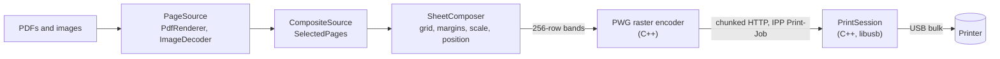

# Free Print

A free, open-source Android app that prints PDFs and images to a **USB printer over OTG**, and scans from the printer's
glass, with no paywall, no account and no internet connection. It is also an Android **print service**, so other apps
can print to the printer through the system print dialog.

> **Status: early.** Printing PDFs, manual two-sided printing and the scanner's protocol all work on a real phone and
> printer. Several newer features are built and unit tested but not yet checked on hardware. See [Status](#status) for
> exactly what has and has not been verified.

## Why

Printing to a USB-only inkjet from a phone usually means a paid app or a vendor app tied to one brand. Many current
printers, however, can be driven without any driver: they speak IPP (the protocol behind AirPrint) over USB. Free Print
talks to them directly, so there is nothing to buy and no per-model driver to write.

The app declares no permissions, in particular not `INTERNET`. Documents never leave the phone.

## Features

**Choosing what to print**
- PDFs and images (JPEG, PNG, WebP and anything Android can decode), picked together, in any mix.
- Several files at once; add more later, remove one, or reorder them.
- Page selection: ranges such as `1-3, 5, 8-`, plus odd or even pages only. Page numbers run across all files.
- Take a page out of the job with the **x** on its thumbnail, and bring everything back with **Restore**; the file itself is untouched.

**Layout** (every option updates a live preview)
- Paper: A4, Letter, A5, Legal, 4 x 6 in.
- Pages per sheet: 1 to 8, in a grid chosen to draw the pages as large as possible (3, 5 and 7 leave spare cells),
  across-then-down or down-then-across order, optional hairline border around each page.
- Orientation: automatic (follows the first page), portrait or landscape.
- Page size: fit, fill (crop) or actual physical size; scale 10 to 400 %.
- Position: a 3 x 3 anchor plus millimetre offsets. Margins: automatic, none, or 0 to 50 mm.
- Colour or grayscale; draft, normal or high quality.
- **Two-sided printing without a duplexer** (see below): the front sides print, you turn the stack over, the back sides print.

**Previewing**
- Live sheet preview that uses the same layout code as the print job, so it shows what will print.
- Strip of sheet thumbnails above the preview, with the active sheet highlighted and the original page numbers as labels.
  Each has a delete button, and the strip only re-centres when you change page, not when you delete one.
- Pages slide in from the right going forward and from the left going back, in the preview and in the viewer.
- Full-screen viewer with pinch zoom (up to 8x), pan, double-tap zoom, swipe to change sheet and its own thumbnail strip.
  It follows the light or dark theme.

**Scanning** (flatbed, over the same USB link)
- Scan pages from the printer's glass: whole glass, A4, Letter, A5, 5 x 7 or 4 x 6 in; resolutions the scanner offers
  (typically 75 to 600 dpi); colour or grayscale.
- One page per tap; scan more pages, then preview, reorder or delete them with the same thumbnail strip and viewer as the
  print screen. Deleted pages can be restored until you clear all.
- Save as a **PDF**, share it, or **print a copy** straight away (the pages open on the print screen).
- The PDF embeds the scanner's JPEG untouched, so files stay small.

**System integration and polish**
- Print service: pick the USB printer from the print dialog of any app (Chrome, Files, Gallery and so on).
- The printer and scanner cards follow the cable: unplug the printer and the app notices at once, plug it in and it comes back.
- English and Sinhala, with an in-app language switch; Android 13's per-app language setting lists both.
- Diagnostics sheet: USB interface dump, IPP attribute query and a raw test page.

## How it works

The G2020 and many other printers expose a second USB interface that carries IPP: class 7, subclass 1, **protocol 4**
(IPP-over-USB). Free Print claims that interface and speaks plain HTTP/IPP over its bulk endpoints, sending the page as
**PWG raster** at 600 dpi.



1. **Open.** Each file becomes a `PageSource` (`PdfRenderer` for PDFs; `ImageDecoder` for images, decoded on demand at
   just the resolution needed). `CompositeSource` joins them into one run of pages; `SelectedPages` applies the page range.
2. **Lay out.** `SheetComposer` places pages on sheets: it picks the grid (`SheetGrid`), applies margins, and uses
   `PageLayout` for fit, scale, anchor, offsets and rotation. It can render any horizontal strip of a sheet.
3. **Stream.** `JobRunner` asks for one 256-row band at a time (about 5 MB), so a full A4 page at 600 dpi (about
   100 MB uncompressed) is never in memory. The native encoder compresses each band to PWG raster and the session sends
   it as an HTTP chunked body, because the total length is not known up front.
4. **Talk USB.** Android's `UsbManager` grants permission and hands over a file descriptor; libusb wraps it
   (`libusb_wrap_sys_device`), claims the IPP interface at its alternate setting and does bulk transfers.
5. **Confirm.** The printer replies with an IPP status; anything other than successful-ok is reported as a failure.

**Two-sided printing** for printers that cannot do it themselves splits the sheets into two passes (`DuplexPlan`): fronts
are sheets 1, 3, 5... and backs are 2, 4, 6.... After the fronts a dialog with an illustration and an animated paper flip
tells you to turn the stack over like a book page and load it the way you loaded blank paper, then **Continue** prints the
backs. *Long edge* prints the backs upright; *short edge* turns every back 180 degrees so the sheet reads correctly when
flipped like a notepad (done while streaming, so no whole page is held in memory). An option prints the backs last-to-first
for printers whose paper stacks the other way round, and an odd number of sides is handled with a note about the last sheet.

**Scanning** uses the same USB interface. The printer also answers **eSCL** (the AirScan protocol) over HTTP there, so the
app asks `GET /eSCL/ScannerCapabilities`, starts a job with `POST /eSCL/ScanJobs`, waits on
`GET <job>/NextDocument` for the JPEG, and deletes the job. `HttpSession` (C++) is the small HTTP client that carries
these requests; `EsclClient` and `ScanViewModel` drive it, and `JpegPdf` builds the PDF.

### Architecture

| Layer | Where | Responsibility |
|---|---|---|
| UI | `ui/PrintScreen.kt`, `ui/ScanScreen.kt`, `MainActivity.kt` | Jetpack Compose screens, popups, language dialog |
| Shared UI | `ui/SharedUi.kt` | The pieces both screens use so they look and behave the same: page strip, zoomable viewer, setting rows, the page-flip transition |
| State | `PrintViewModel.kt`, `scan/ScanViewModel.kt`, `UsbWatcher.kt` | Files, options, previews, thumbnails, restore points, job state; all slow work on `Dispatchers.IO`; USB plug and unplug events |
| Layout and sources | `print/` | `PageSource`, `CompositeSource`, `PageSelection`, `PageLayout`, `SheetGrid`, `SheetComposer`, `Options`, `Duplex`, `ThumbRemap` |
| Job running | `print/JobRunner.kt`, `JobExecutor.kt` | Streams bands, handles cancellation, checks the printer's reply |
| USB and JNI | `UsbPrinter.kt`, `PrintSession.kt`, `NativeIpp.kt` | Find the printer, ask permission, call native code |
| Native | `app/src/main/cpp/` | `pwg_encoder.h` (PWG raster), `ipp_usb.h` (IPP and interface helpers), `print_session.cpp` (streaming job), `ippusb.cpp` (one-shot diagnostics) |
| Scanning | `scan/`, `HttpSession.kt`, `ui/ScanScreen.kt`, `cpp/http_session.cpp` | eSCL parsing and requests, the scan state, the JPEG-to-PDF writer, the scan screen, a generic HTTP/1.1 client over IPP-over-USB |
| System print | `printservice/` | `UsbPrintService`, `UsbDiscoverySession`, `PrinterProfile` |
| i18n | `AppLocale.kt`, `res/values*/`, `tools/gen_strings.py` | Language choice and generated string files |

Decisions worth knowing:

- **Driverless over a driver library.** Gutenprint was tried first and the printer accepted its data but printed nothing;
  IPP worked straight away. See [docs/findings.md](docs/findings.md).
- **One layout path for preview and print.** The preview, thumbnails and print job all call `SheetComposer`, so they cannot
  disagree. The pure maths (`PageLayout.place`, `SheetGrid`, `PageSelection`) has no Android types and is unit tested on the JVM.
- **Units belong to the page.** A PDF page is in points and a photo is in pixels, so units per inch are asked per page;
  that is what lets "actual size" work in a mixed job.
- **The printer feeds portrait.** A landscape sheet is laid out wide, then turned a quarter turn counter-clockwise into
  the raster; the preview turns it back.
- **No whole-page buffers.** Bands, lazy thumbnails (an 80-entry cache) and a single shared decoded-image cache keep memory flat.
  Removing a page keeps the thumbnails that are still right and redraws only the rest (`ThumbRemap`).
- **Deleting is reversible.** On the print screen it only edits the page selection, so restoring puts the old selection back; on
  the scan screen deleted pages are kept aside (`PageTrash`) until you clear all.

## Requirements

- **Phone:** Android 8.0 (API 26) or newer, **arm64** (the native libraries are built for arm64-v8a only), USB host
  support and a USB OTG adapter.
- **Printer:** one that exposes IPP-over-USB (USB interface class 7, subclass 1, protocol 4) and accepts
  `image/pwg-raster` at 600 dpi. Many recent AirPrint-capable printers do. The way to check is the **Interfaces** and
  **IPP attributes** buttons in the app's diagnostics sheet.
- **Tested on:** Canon PIXMA G2020 with a Samsung Galaxy S25 Ultra (Android 17). Nothing else has been tried.

## Build

You need JDK 17, the Android SDK (platform 35, build-tools 35.0.0), NDK 27.2.12479018 and CMake 3.22.1. The Gradle
wrapper (8.10.2) does the rest.

```sh
export JAVA_HOME=/path/to/jdk17
export ANDROID_HOME=/path/to/android-sdk     # or create local.properties with sdk.dir=...
./gradlew assembleDebug                      # app/build/outputs/apk/debug/app-debug.apk
./gradlew testDebugUnitTest                  # 105 JVM unit tests
```

The application ID is `crescentric.freeprint.otg`. Because the phone's only USB-C port is taken by the printer, install and
read logs over wireless debugging.
[docs/dev-setup.md](docs/dev-setup.md) covers the toolchain, wireless adb, enabling the print service and the string workflow.

## Using it

**In the app:** connect the printer through the OTG adapter, tap *Allow USB access*, choose files, adjust the settings
(each opens a popup), check the preview and press **Print**.

**Scanning:** on the start screen open **Scan a document**, put a page face down on the glass, choose area, resolution
and colour, and tap **Scan page**. A page can take up to a minute at high resolution. Tap again for more pages, then
**Print a copy**, **Save PDF** or **Share**.

**Two-sided:** in the settings open *Two-sided printing* and choose the long or short edge. The button then reads *Print front
sides*. When the dialog appears, follow its steps and tap *Continue*. If the backs come out in the wrong order, switch on
*Print the back sides in reverse order*. Neither edge choice adds extra space for binding; use *Margins* for that.

**From other apps:** enable *Free Print* under Settings, Connections, More connection settings, Printing (the path
varies by phone). Then choose the printer in any app's print dialog. Paper size, colour mode and copies come from that
dialog; copies are sent to the printer as an IPP attribute.

## Languages

English and Sinhala. All text lives in `values/strings.xml` and `values-si/strings.xml`, which are **generated** from one
table so they cannot drift apart:

```sh
python3 -I tools/gen_strings.py     # edit the table in that file, then run it
```

The Sinhala wording has not been reviewed by a native speaker; corrections are very welcome.

## Testing

| What | How |
|---|---|
| Layout, grid, page ranges and their text form, margins, combined sources, two-sided passes, thumbnail and deleted-page bookkeeping, eSCL parsing and requests, the PDF writer, viewer colours | 105 JVM unit tests (`app/src/test`) |
| PWG raster encoder | `tools/pwg-test`: encodes 108 tricky images with sanitizers and checks them pixel for pixel with an independent Python decoder |
| USB and IPP protocol | `tools/mac-spike`: small C programs and a PWG generator that drive the printer from a Mac with libusb |
| Everything on real hardware | Manual, on the phone and printer above |

## Repository layout

```
app/                    the Android app (Kotlin, Compose, JNI)
  src/main/java/...      UI, view-model, print pipeline, print service, scanner
  src/main/cpp/          PWG encoder, IPP-over-USB session, vendored libusb 1.0.30
  src/test/              JVM unit tests
docs/                   findings (printer and protocol), process log, dev setup
tools/                  string generator, PWG encoder host test, Mac protocol spike
LICENSE                 GNU GPL v3
```

## Status

**Verified on the Canon G2020 and Galaxy S25 Ultra:** discovering the IPP-over-USB interfaces, Get-Printer-Attributes,
printing a test page, streaming PDFs with chunked transfer (including a real PDF from the phone), and **manual two-sided
printing** (both passes). For scanning, the capabilities and status requests are answered, scan jobs are accepted, and two
pages came back over eSCL (4.5 MB and 1.2 MB JPEGs, confirmed in the device log).

**Built and unit tested, but not yet checked on hardware:** how scanned pages look and what Print a copy, Save PDF and Share
produce; the print service; landscape direction; mixed PDF and image jobs; the on-demand image decoding path; n-up layouts,
scale, margins and position; grayscale; deleting and restoring pages; live printer detection; the flip animation; the viewer in
light theme; the language switch.

**Not measured:** how close to the paper edge the printer actually prints, so margins below a few millimetres may be clipped.

## Limitations and ideas

- Manual two-sided printing assumes the printer picks the top sheet and puts paper out face up. Printers that behave differently
  may need the reverse option. If the second pass fails, the job has to be started again, and there is no extra binding margin.
- Scanning is flatbed only (the G2020 has no document feeder), one page per scan, and cannot be cancelled once started.
- Only the 600 dpi PWG raster path exists. Printers that want PDF or URF only, or lack 600 dpi, are not supported yet.
- No job-status polling yet: the app reports whether the printer accepted the job, not whether the page came out.
- A job cancelled mid-stream leaves the printer waiting for the rest of the page; a power cycle may be needed.
- Capabilities (paper sizes, colour) are hard-coded for now rather than read from the printer.
- Possible additions: reading capabilities from IPP, job status and ink levels, URF output, and fallbacks (a PCL encoder, or
  Gutenprint) for printers that do not speak IPP over USB.

## Contributing

Reports from other printers are the most useful contribution. Run **Interfaces** and **IPP attributes** from the
diagnostics sheet and open an issue with the output and what happened when you printed the test page. Code changes should
keep `./gradlew testDebugUnitTest` green; the pure layout maths is the easiest place to start.

## Licence

Free Print is licensed under the **GNU General Public License v3.0**; see [LICENSE](LICENSE).

It bundles [libusb](https://libusb.info) 1.0.30 as source under `app/src/main/cpp/third_party/libusb/`, licensed under
the LGPL 2.1 or later (its `COPYING` is alongside), which is compatible with distributing the combined app under GPL v3.
