<div align="center">

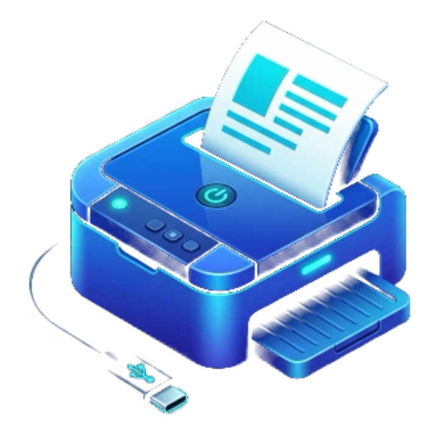

# Free Print

**Print and scan from your phone over a USB cable.**<br>
No drivers. No internet. No ads. No account. Free software.

[](LICENSE)
[](CHANGELOG.md)
[-3DDC84.svg)](#requirements)
[](#requirements)
[](#privacy)
[](#how-it-works)
[](docs/fdroid.md)
[](https://github.com/Crescentric-Labs/freeprint/actions/workflows/ci.yml)
[](https://github.com/Crescentric-Labs/freeprint/releases/latest)
[](https://github.com/Crescentric-Labs/freeprint/releases)

[Features](#features) ·
[Screenshots](#screenshots) ·
[Install](#install) ·
[Using it](#using-it) ·
[Developer setup](#developer-setup) ·
[How it works](#how-it-works) ·
[Changelog](CHANGELOG.md) ·
[Contributing](CONTRIBUTING.md)

</div>

---

Free Print prints PDFs, pictures and text to a **USB printer plugged into your phone with an OTG adapter**, and scans from
the printer's glass over the same cable. It is also an Android **print service**, so every other app can print to the
printer from Android's own print dialog.

It works without any printer driver because most printers made in the last decade can speak **IPP** (the protocol behind
AirPrint) over USB. Free Print talks to them directly, so there is nothing to buy, nothing to install on the printer and no
per-model driver to write.

> **Honest status.** Printing, manual two-sided printing and scanning work on the author's Canon PIXMA G2020 with a Samsung
> Galaxy S25 Ultra. Nothing else has been tried yet, and many of the newer features are unit tested and used on the phone
> but not yet checked on paper. [Status](#status) says exactly which is which. Reports from other printers are the most
> valuable contribution: see [Printer reports](CONTRIBUTING.md#printer-reports).

## Screenshots

<table>
  <tr>
    <td align="center" valign="top" width="33%">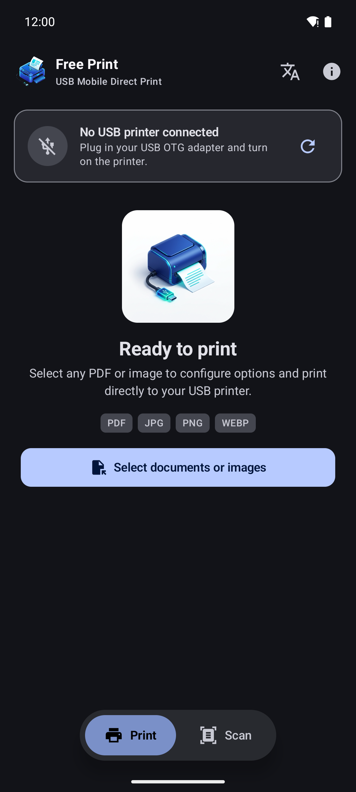<br><sub><b>Print</b><br>start screen and dock</sub></td>
    <td align="center" valign="top" width="33%">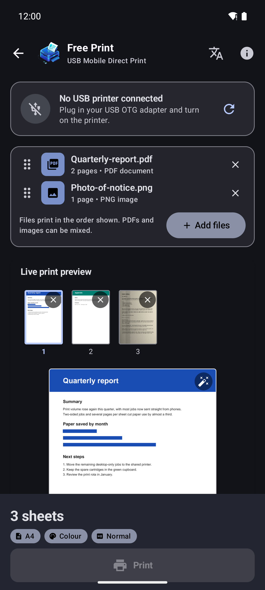<br><sub><b>PDFs and pictures together</b><br>mix them, drag to reorder</sub></td>
    <td align="center" valign="top" width="33%">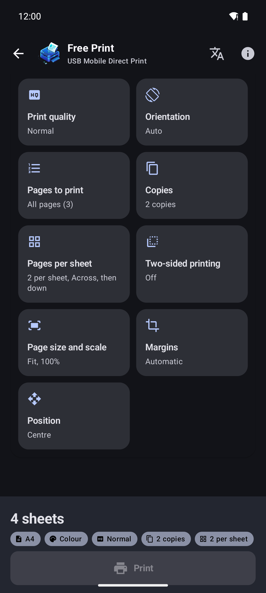<br><sub><b>Every setting</b><br>tiles, and the bar shows what is set</sub></td>
  </tr>
  <tr>
    <td align="center" valign="top" width="33%">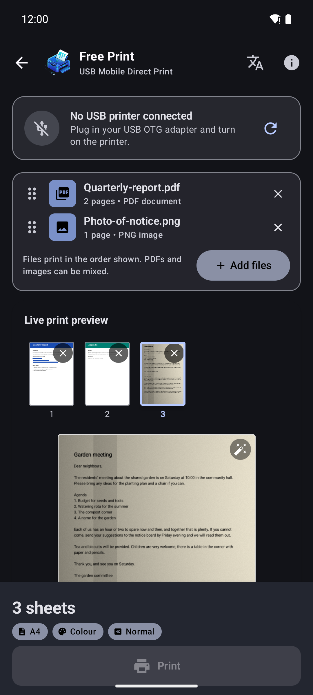<br><sub><b>Optimize for print</b><br>a photo of a notice, shadows and grey paper</sub></td>
    <td align="center" valign="top" width="33%">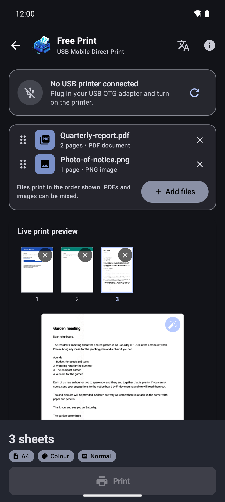<br><sub><b>...one tap later</b><br>white paper, even light, crisp ink</sub></td>
    <td align="center" valign="top" width="33%">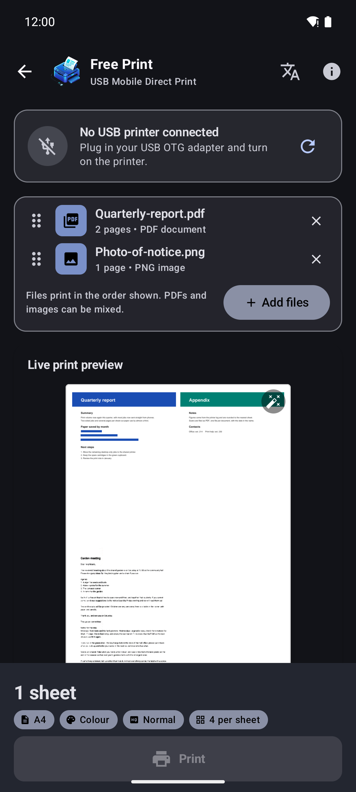<br><sub><b>Several pages per sheet</b><br>two PDF pages and the photo on one sheet</sub></td>
  </tr>
  <tr>
    <td align="center" valign="top" width="33%">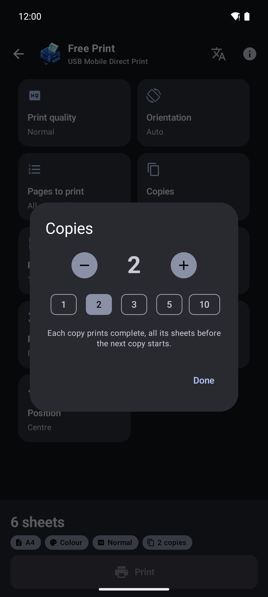<br><sub><b>Copies</b><br>collated, up to 99</sub></td>
    <td align="center" valign="top" width="33%">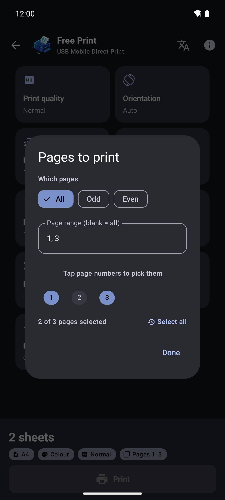<br><sub><b>Pages to print</b><br>ranges, odd or even, tap-to-pick pills</sub></td>
    <td align="center" valign="top" width="33%">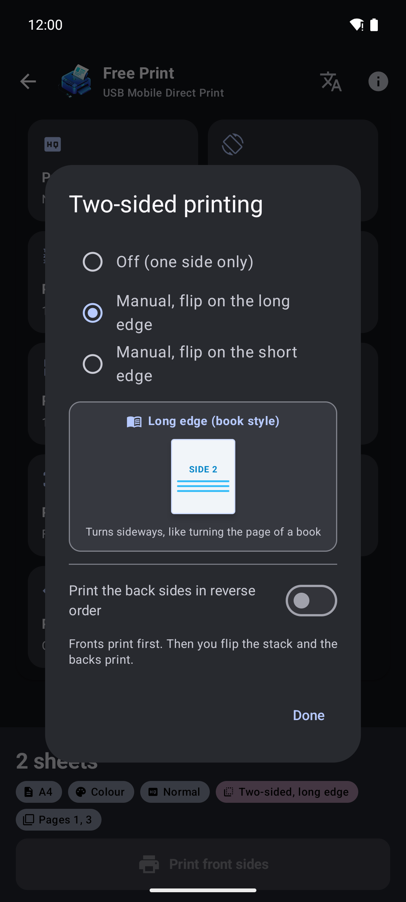<br><sub><b>Two-sided without a duplexer</b><br>long or short edge, guided flip</sub></td>
  </tr>
  <tr>
    <td align="center" valign="top" width="33%">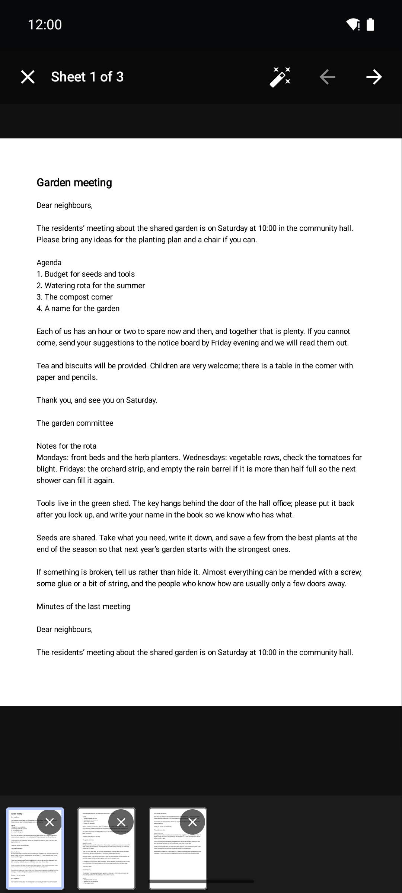<br><sub><b>Full-screen viewer</b><br>zoom, pan, swipe, optimize</sub></td>
    <td align="center" valign="top" width="33%">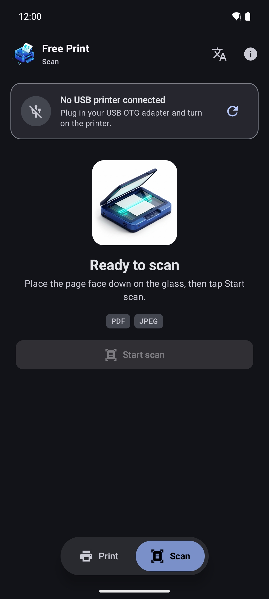<br><sub><b>Scan</b><br>over the same USB cable</sub></td>
    <td align="center" valign="top" width="33%">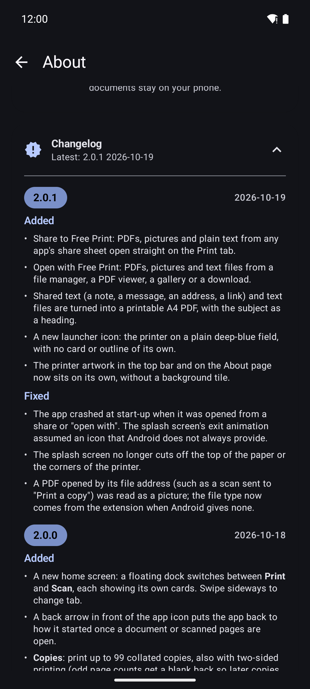<br><sub><b>About</b><br>licences, diagnostics, changelog</sub></td>
  </tr>
  <tr>
    <td align="center" valign="top" width="33%">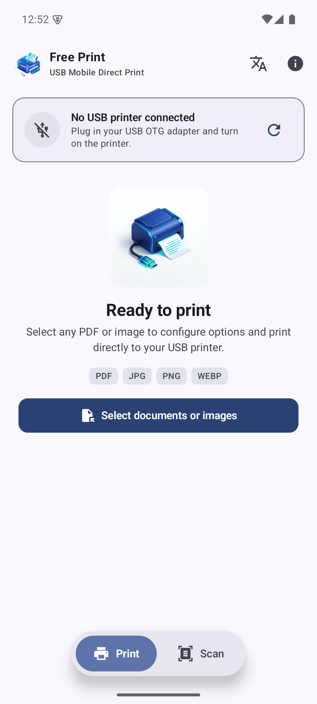<br><sub><b>Light theme: Print</b><br>follows the phone</sub></td>
    <td align="center" valign="top" width="33%">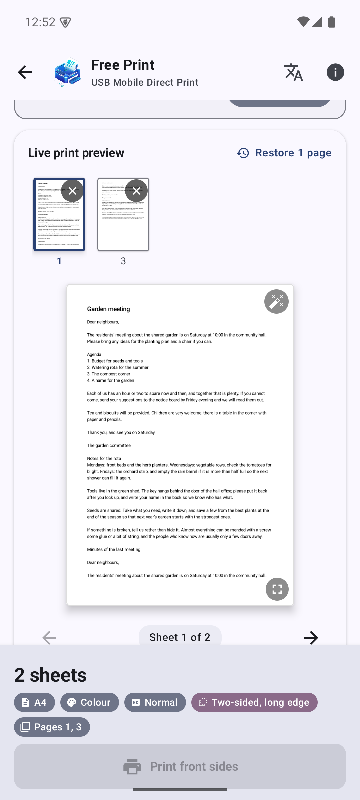<br><sub><b>Light theme: preview</b><br>document and page strip</sub></td>
    <td align="center" valign="top" width="33%">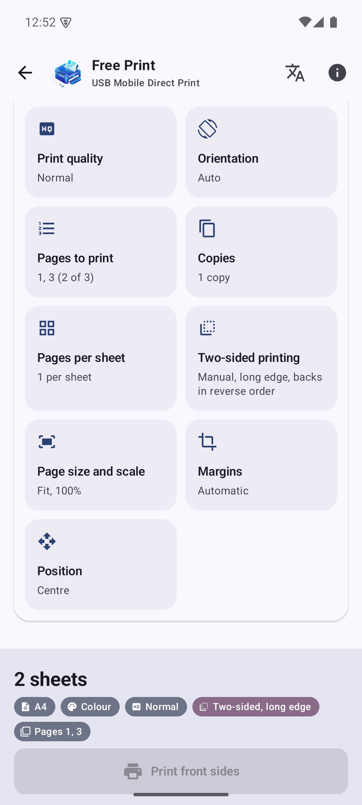<br><sub><b>Light theme: settings</b><br>two-sided is highlighted on the bar</sub></td>
  </tr>
  <tr>
    <td align="center" valign="top" width="33%">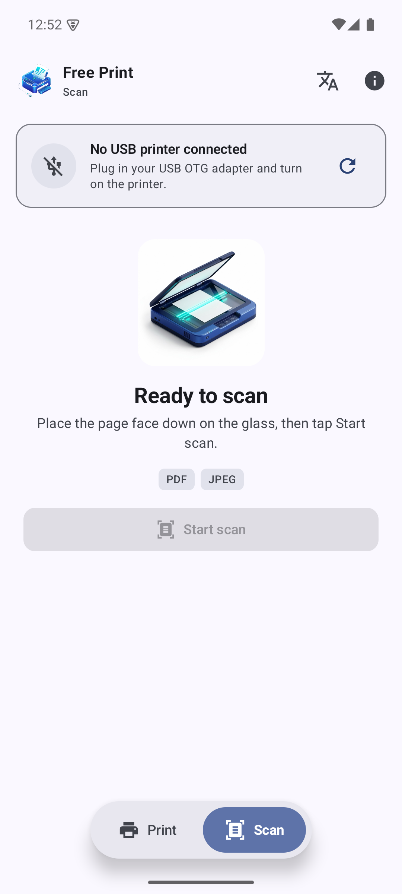<br><sub><b>Light theme: Scan</b><br>the same cable, in light</sub></td>
    <td align="center" valign="top" width="33%">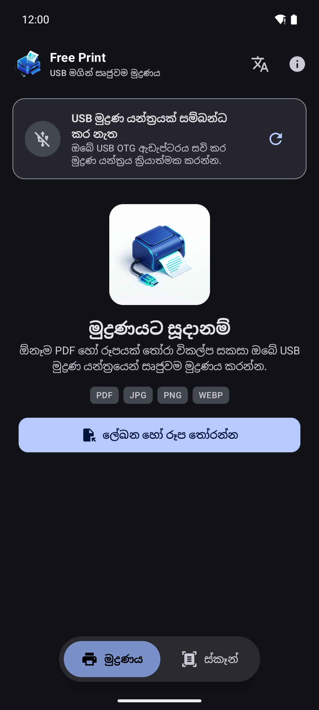<br><sub><b>Sinhala (සිංහල)</b><br>switch language inside the app</sub></td>
    <td align="center" valign="top" width="33%">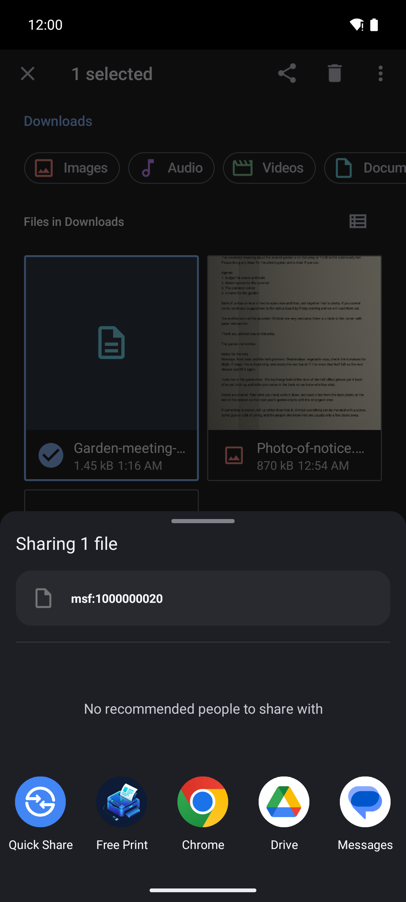<br><sub><b>Share to Free Print</b><br>listed in Android's share sheet</sub></td>
  </tr>
</table>

<sub>Screenshots are taken in an Android emulator, which has no USB host, so the printer card says "No USB printer connected". Everything else is the real app. The sample PDF and the photographed notice are made-up demo files. The dark and light themes both follow the phone.</sub>

## Features

### Print

- **PDFs, pictures and text**, picked together in any mix, in one job. Add more files later, remove one, drag to reorder.
- **Share to Free Print** or **Open with** from any app: PDFs, pictures and plain text (notes, messages, addresses, links).
  Shared text is turned into a clean A4 PDF first.
- **Live preview** drawn by the same code that prints, so it shows what will come out. A strip of sheet thumbnails, swiping
  between sheets with a page-turn animation, and a full-screen viewer with pinch zoom (up to 8x), pan and double-tap zoom.
- **Choose pages**: ranges like `1-3, 5, 8-`, odd or even only, or tap page-number pills. Take any sheet out with the **x** on
  its thumbnail, and bring everything back with **Restore**. The file is never modified.
- **Layout**: 1 to 8 pages per sheet (across or down, optional borders), portrait or landscape, fit / fill / actual size,
  10 to 400 % scale, margins, 3 x 3 position with millimetre offsets.
- **Paper**: A4, Letter, A5, A6, B5, Legal, Executive, 4 x 6, 5 x 7 and 8 x 10 in. Colour or grayscale, draft / normal / high.
- **Copies**: up to 99, collated, also with two-sided printing.
- **Two-sided printing without a duplexer**: the fronts print, an animated guide shows how to turn the stack, the backs print.
  Long or short edge, reverse order, and a way to carry on to the backs if the fronts reported an error but printed anyway.
- **Pause** a running job between sheets, and resume.
- **Optimize for print** for photographed documents: whitens the paper, evens out shadows and uneven light, deepens the ink.
  Per page, on pictures, PDF pages and scans, and always undoable.
- **System print service**: choose the USB printer in the print dialog of Chrome, Files, Gallery or any other app.

### Scan

- **Flatbed scanning over the USB cable** (eSCL, also called AirScan): area, resolution (as the scanner offers, typically
  75 to 600 dpi) and colour or grayscale.
- Scan several pages; preview, delete and restore them with the same strip and viewer as printing; optimize any page.
- **Save as a PDF or as pictures**, either page by page as scanned or **laid out on paper sheets** with the print settings
  (paper, orientation, pages per sheet, size and scale, margins, position, colour). Or **share** it, or **print a copy**.
- Unmodified pages go into the PDF as the scanner's own JPEG, so files stay small.

### The app itself

- **Private by construction**: no Android permissions at all, in particular no `INTERNET`. See [Privacy](#privacy).
- **Material 3** with dynamic colour, light and dark, a floating dock to switch between Print and Scan, and swiping between them.
- **English and Sinhala** (සිංහල), switchable inside the app or in Android's per-app language setting.
- **Notices the cable**: plug the printer in and the app says so at once; unplug it and the card changes.
- **Diagnostics** for printer makers and curious people: USB interface dump, IPP attributes, a raw test page.
- **Changelog inside the app**: About → Changelog.

## Install

| Source | Status |
|---|---|
| **F-Droid** | Submission planned; the project is prepared for it ([docs/fdroid.md](docs/fdroid.md)). Not listed yet |
| **GitHub Releases** | Signed APKs will be attached to each tagged release |
| **Build it yourself** | See [Developer setup](#developer-setup) |

After installing, plug the printer into the phone with a USB OTG adapter and its normal USB cable, switch the printer on, and
open the app. Android asks once whether Free Print may use the USB device; allow it (choose "Always" to skip the question later).

### Requirements

| | |
|---|---|
| Phone | Android 8.0 (API 26) or newer, **64-bit ARM** (arm64-v8a), with USB host (OTG) support |
| Cable | A USB OTG adapter or cable, plus the printer's own USB cable |
| Printer | One that exposes the **IPP-over-USB** interface (USB class 7, subclass 1, protocol 4) and accepts `image/pwg-raster` at 600 dpi. Most AirPrint-capable USB printers do |
| Scanner | The printer's scanner must answer **eSCL** over that same interface (the G2020's does) |

The app's **About → Diagnostics → Interfaces** button tells you whether your printer has the interface.

### Printers known to work

| Printer | Print | Duplex (manual) | Scan | Reported by |
|---|:-:|:-:|:-:|---|
| Canon PIXMA G2020 | ✅ | ✅ | ✅ | the author |
| *your printer here* | | | | [send a printer report](../../issues/new?template=printer-report.yml) |

## Using it

**Print.** Open the app, tap **Select documents or images** (or share a file to Free Print from another app). Check the
preview, change anything in the settings tiles (each opens a popup), and press **Print**. The bar at the bottom shows how many
sides will come out and the settings in effect.

**Two-sided.** Open *Two-sided printing* and choose the long or short edge. The button then reads *Print front sides*. When the
dialog appears, turn the stack over as it shows and tap *Continue*. If the backs come out in the wrong order, switch on *Print
the back sides in reverse order*. Neither choice adds a binding margin; use *Margins* for that.

**Scan.** Switch to the **Scan** tab (tap it in the dock, or swipe), put the page face down on the glass, and tap **Start
scan**. A page can take up to a minute at high resolution. Scan more pages, then **Save**, **Share** or **Print a copy**.
In the save dialog, turn on *Lay out on paper* to put the pages on sheets with the print settings.

**Print from other apps.** Turn the service on once under *Settings → Connected devices → Connection preferences → Printing*
(the path varies by phone) and switch on **Free Print**. Then pick the printer in any app's print dialog. Paper size, colour mode
and copies come from that dialog.

**Back to the start.** Once something is open, a back arrow in front of the app icon resets the app (scanned pages ask first).

### Troubleshooting

| Problem | Try |
|---|---|
| "No USB printer connected" | Check the OTG adapter and cable, switch the printer on, tap the refresh icon. Run **Diagnostics → Interfaces** and look for class 7 / subclass 1 / protocol 4 |
| The permission dialog never appears | Unplug and re-plug the printer; check no other app (a vendor print app) has claimed it |
| Printer detected, nothing prints | Run **IPP attributes** and check `image/pwg-raster` is in `document-format-supported`; load A4 paper; send a [printer report](CONTRIBUTING.md#printer-reports) |
| "The printer rejected the job" after a long job | Update to 2.0.0 or newer (the wait for the printer's reply was too short before) |
| Backs of a two-sided job come out in the wrong order | Turn on *Print the back sides in reverse order* |
| The edge of the page is clipped | Add a small margin in *Margins*; the printer's own unprintable edge is not yet measured |
| Scanning says it is not a scanner | Some printers expose no eSCL; send a printer report |
| Print service missing from the system print dialog | Enable it under the phone's *Printing* settings |

## Privacy

- **No permissions.** The manifest declares none. The app cannot use the network, read your storage, or see your contacts.
- **No tracking, no analytics, no ads, no accounts.** Nothing is sent anywhere, because the app has no way to send it.
- **Your files stay on the phone.** They are read only when you pick them, share them to the app, or open them with it; temporary
  copies (scanned pages, shared text turned into a PDF) live in the app's private cache.
- **USB access is per device and per decision**, through Android's own permission dialog.
- You can check all of this: the code is here, and F-Droid builds it from source.

Report security problems privately: see [SECURITY.md](SECURITY.md).

## At a glance

| | |
|---|---|
| App ID | `crescentric.freeprint.otg` |
| Version | 2.0.1 (versionCode 4); see the [changelog](CHANGELOG.md) |
| Licence | GPL-3.0 (libusb 1.0.30, LGPL-2.1+, bundled) |
| Android | min 8.0 (API 26), target and compile 35 |
| ABI | arm64-v8a only |
| Release APK | about **11.9 MB** unsigned (`assembleRelease`, no minification); debug about 17.6 MB |
| Native code | about 750 lines of C++ of our own, plus vendored libusb |
| Permissions | **none** |
| Dependencies | 8 libraries: AndroidX (core, activity, lifecycle, splash screen), Jetpack Compose (UI, Material 3, icons, via the Compose BOM) and kotlinx.coroutines. All Apache-2.0 |
| Languages | English, Sinhala (275 strings and 8 plurals in each) |
| Source | 38 Kotlin files (about 7.3k lines), 14 test classes (about 0.8k lines), C++ with libusb, build tooling in Gradle Kotlin DSL |
| Tests | **119 unit tests** on the JVM, all passing, plus 108 encoder cases checked pixel by pixel on the host (`tools/pwg-test`) |
| History | 290+ commits, one file per commit |
| Build | Gradle 8.10.2, AGP 8.7.3, Kotlin 2.0.21, JDK 17, NDK 27.2, CMake 3.22.1 |

## Releases and deployment

| | |
|---|---|
| Latest release | **2.0.1** (versionCode 4), published 2026-10-19 |
| Releases so far | 4 (one pre-release), all on [GitHub Releases](https://github.com/Crescentric-Labs/freeprint/releases) |
| Every release has | a signed APK, a `.sha256` checksum file, and its section of the [changelog](CHANGELOG.md) as the release notes |
| Distribution | GitHub Releases: **live**. F-Droid: **prepared, not yet submitted** ([docs/fdroid.md](docs/fdroid.md)). Google Play: not planned |
| Signing | one release key, the same for every release. Certificate SHA-256: `9df7c9acd30f81b3b0ab139163c33e99c6bd4a549a3c6bc17dede7c4bd0f937f` |
| APK signature schemes | v2 and v3 (minimum Android 8.0) |
| Pipeline | a `vX.Y.Z` tag → [GitHub Actions](.github/workflows) builds and tests it → a signed APK and the changelog become the release. Done on a laptop today with `tools/release.sh`; Actions can take over once the signing secrets are added ([docs/releasing.md](docs/releasing.md)) |
| Continuous integration | on every push and pull request: strings in step with the generator, 119 unit tests, a debug build and a release build, and a check that the changelog has an entry for the version. A full run takes about 10 minutes from a cold cache |
| Local release build | about a minute (`./gradlew assembleRelease`) |
| Store listing | F-Droid metadata ready in `fastlane/`: 1 language (en-US), title, short and full description, 2 version changelogs, icon and 8 screenshots |
| Reproducible builds | not yet; F-Droid signs with its own key |

| Version | versionCode | Released | APK size | SHA-256 (start) | Notes |
|---|:-:|---|--:|---|---|
| [2.0.1](https://github.com/Crescentric-Labs/freeprint/releases/tag/v2.0.1) | 4 | 2026-10-19 | 11.9 MiB | `044649d2148e…` | share and open-with, text to PDF, new icon, in-app changelog |
| [2.0.0](https://github.com/Crescentric-Labs/freeprint/releases/tag/v2.0.0) | 3 | 2026-10-19 | 12.1 MiB | `1a7ace8ed174…` | home screen and dock, copies, pause, optimize for print, scan saving |
| [1.0.0](https://github.com/Crescentric-Labs/freeprint/releases/tag/v1.0.0) | 1 | 2026-10-19 | 11.9 MiB | `c8ee66738cf8…` | About screen, licences |
| [0.1.0](https://github.com/Crescentric-Labs/freeprint/releases/tag/v0.1.0) | 1 | 2026-10-19 | 11.9 MiB | `2b1683c710f2…` | first working version (pre-release, other app ID) |

<sub>The version dates are when each release was published on GitHub; the changelog gives the dates the work was done (all between 2026-10-11 and 2026-10-19). Download counts are on the release pages and in the badge above; they are not copied here so they cannot go stale. The badges work once the repository is public.</sub>

## Developer setup

You need a computer with about 6 GB free for the SDK, NDK and Gradle caches. The steps are for macOS and Linux; on Windows use
`gradlew.bat` and set the variables with `setx`, or use Android Studio, which does it for you.

### 1. Install the tools

| Tool | Version | Notes |
|---|---|---|
| JDK | **17** | Newer JDKs are too new for this Android Gradle Plugin. macOS: `brew install openjdk@17` |
| Android SDK | platform **35**, build-tools **35.0.0** | via Android Studio or `sdkmanager` |
| Android NDK | **27.2.12479018** (r27c) | side by side, via `sdkmanager "ndk;27.2.12479018"` |
| CMake | **3.22.1** | `sdkmanager "cmake;3.22.1"` |
| Gradle | 8.10.2 | not needed: the wrapper downloads it |
| Python 3 | any recent | only for `tools/gen_strings.py` |

With the command-line tools alone:

```sh
sdkmanager "platform-tools" "platforms;android-35" "build-tools;35.0.0" "ndk;27.2.12479018" "cmake;3.22.1"
sdkmanager --licenses
```

### 2. Point the build at them

```sh
export JAVA_HOME=/path/to/jdk-17
export ANDROID_HOME=/path/to/android-sdk            # or put sdk.dir=... in local.properties (git-ignored)
export PATH="$ANDROID_HOME/platform-tools:$PATH"
```

### 3. Build, test, install

```sh
git clone https://github.com/Crescentric-Labs/freeprint.git
cd freeprint

./gradlew testDebugUnitTest          # 119 unit tests, a few seconds
./gradlew assembleDebug              # app/build/outputs/apk/debug/app-debug.apk
./gradlew assembleRelease            # app/build/outputs/apk/release/app-release-unsigned.apk (what F-Droid builds)
adb install -r app/build/outputs/apk/debug/app-debug.apk
```

The first build downloads Gradle and dependencies and compiles libusb; expect a few minutes. Opening the folder in Android Studio
(Ladybug or newer) also works.

### 4. Run it

**On a phone.** The phone's only USB-C port is needed for the printer, so use **wireless debugging**:
Developer options → Wireless debugging → Pair device with pairing code, then

```sh
adb pair <ip>:<pairing-port>          # enter the six-digit code
adb connect <ip>:<connect-port>       # the port shown on the Wireless debugging screen
adb logcat FreePrintNative:I AndroidRuntime:E '*:S'
```

**In an emulator (AVD).** Useful for everything except talking to a printer, because Android emulators have no USB host. Use an
**arm64** image (the app ships arm64 libraries only), which runs natively on Apple Silicon and Arm machines:

```sh
sdkmanager "emulator" "system-images;android-35;google_apis;arm64-v8a"
avdmanager create avd -n freeprint -k "system-images;android-35;google_apis;arm64-v8a" -d pixel_8
$ANDROID_HOME/emulator/emulator -avd freeprint
```

On an x86-64 PC the arm64 app will not run in an x86 image; use a physical phone there. Shares and "open with" can be tried in
the emulator (`adb shell am start -a android.intent.action.SEND -t text/plain --es android.intent.extra.TEXT hello ...`).

### 5. Everyday tasks

| Task | How |
|---|---|
| Run the tests | `./gradlew testDebugUnitTest` (reports in `app/build/reports/tests/`) |
| Change or add text | Edit the table in `tools/gen_strings.py`, run `python3 -I tools/gen_strings.py`. **Never** edit `res/values*/strings.xml` by hand |
| Test the PWG raster encoder on the host | `tools/pwg-test` (compiles `gen.cpp` with sanitizers, checks output with `check.py`) |
| Drive a printer from a Mac without Android | `tools/mac-spike/README.md` |
| Read logs from native code | `adb logcat FreePrintNative:I AndroidRuntime:E '*:S'` |
| Check the print service | `adb shell dumpsys print` |
| Update the changelog | Add a line under `## [Unreleased]` in `CHANGELOG.md`; the app shows that file |
| Cut a release | [docs/fdroid.md](docs/fdroid.md#releasing-a-new-version) |

More detail: [docs/dev-setup.md](docs/dev-setup.md), [docs/findings.md](docs/findings.md) (what was learned about the printer and
the protocols) and [docs/process.md](docs/process.md) (the dead ends, so you do not repeat them).

### Project layout

```
app/                       the Android app
  src/main/java/...          UI (Compose), view models, print pipeline, scanner, print service
  src/main/cpp/              PWG raster encoder, IPP-over-USB sessions (JNI), vendored libusb 1.0.30
  src/test/                  JVM unit tests
fastlane/metadata/         F-Droid store texts, changelogs, icon and screenshots
docs/                      findings, process log, dev setup, F-Droid guide, screenshots
tools/                     string generator, PWG host test, Mac protocol spike
.github/                   issue and pull request templates
CHANGELOG.md               release notes (also shown in the app)
LICENSE                    GNU GPL v3
```

## How it works

Many printers expose a second USB interface carrying IPP: class 7, subclass 1, **protocol 4**. Free Print claims that interface
and speaks plain HTTP and IPP over its bulk endpoints, sending each page as **PWG raster** at 600 dpi. The same interface also
answers **eSCL** requests, which is how scanning works.

```mermaid
flowchart LR
    A["PDFs, pictures, text"] --> B["PageSource<br/>PdfRenderer, ImageDecoder"]
    B --> C["CompositeSource<br/>SelectedPages"]
    C --> D["SheetComposer<br/>grid, margins, scale, position"]
    D -->|"256-row bands"| E["PWG raster encoder<br/>(C++)"]
    E -->|"chunked HTTP, IPP Print-Job"| F["PrintSession<br/>(C++, libusb)"]
    F -->|"USB bulk"| G[("Printer")]
    G -.->|"eSCL scan over the same link"| H["HttpSession (C++)"]
    H --> I["JPEG pages, PDF writer"]
```

1. **Open.** Each file becomes a `PageSource` (`PdfRenderer` for PDFs, `ImageDecoder` for pictures decoded on demand at just
   the resolution needed). `CompositeSource` joins them into one run of pages; `SelectedPages` applies the page range.
2. **Lay out.** `SheetComposer` places pages on sheets: it picks the grid, applies margins, and uses `PageLayout` for fit, scale,
   anchor, offsets and rotation. It can render any horizontal strip of a sheet.
3. **Stream.** `JobRunner` asks for one 256-row band at a time (about 5 MB), so a full A4 page at 600 dpi (about 100 MB
   uncompressed) is never in memory. The native encoder compresses each band and the session sends it as an HTTP chunked body.
4. **Talk USB.** Android's `UsbManager` grants permission and hands over a file descriptor; libusb wraps it
   (`libusb_wrap_sys_device`), claims the IPP interface and does bulk transfers.
5. **Confirm.** The printer replies with an IPP status when it has taken the whole job, which for a long job can be minutes later;
   anything other than successful-ok is reported as a failure.

Design decisions worth knowing:

- **Driverless over a driver library.** Gutenprint was tried first: the printer accepted its data and printed nothing. IPP worked
  straight away. ([docs/findings.md](docs/findings.md))
- **One layout path for preview and print.** Previews, thumbnails, saved scans and the print job all call `SheetComposer`, so they
  cannot disagree. The pure maths has no Android types and is unit tested on the JVM.
- **Units belong to the page.** A PDF page is in points and a photo in pixels, so "actual size" works in a mixed job.
- **The printer feeds portrait.** A landscape sheet is laid out wide, turned a quarter turn into the raster, and turned back for the preview.
- **No whole-page buffers.** Bands, lazy thumbnails and a shared decoded-image cache keep memory flat.
- **Copies are made by the app**, not requested from the printer, so collation and two-sided pairing do not depend on the printer.
- **Optimize for print** estimates the paper's brightness on a coarse grid, divides each pixel by it, then applies a levels curve;
  for PDFs the estimate comes from a small render of the whole page, so no seams appear between print bands.

| Layer | Where |
|---|---|
| UI (Compose) | `ui/HomeScreen.kt`, `PrintScreen.kt`, `ScanScreen.kt`, `AboutScreen.kt`, `LayoutSettings.kt`, `SharedUi.kt` |
| State | `PrintViewModel.kt`, `scan/ScanViewModel.kt`, `UsbWatcher.kt` |
| Layout and sources | `print/` (`PageSource`, `CompositeSource`, `PageSelection`, `PageLayout`, `SheetGrid`, `SheetComposer`, `Duplex`, `DocEnhance`, `TextPdf`...) |
| Job running | `print/JobRunner.kt`, `JobExecutor.kt` |
| USB and JNI | `UsbPrinter.kt`, `PrintSession.kt`, `HttpSession.kt`, `NativeIpp.kt` |
| Native | `app/src/main/cpp/` (`pwg_encoder.h`, `ipp_usb.h`, `print_session.cpp`, `http_session.cpp`, `ippusb.cpp`) |
| Scanning | `scan/` (`Escl`, `EsclClient`, `JpegPdf`, `PageTrash`) |
| System print | `printservice/` |
| Languages | `AppLocale.kt`, `res/values*/`, `tools/gen_strings.py` |

## Status

**Checked on the Canon G2020 and the Galaxy S25 Ultra:** discovering the IPP-over-USB interfaces; printer attributes; a test page;
streaming PDFs; printing a PDF from the phone; **manual two-sided printing** (both passes); eSCL scanning (capabilities, jobs, two
pages back, 4.5 MB and 1.2 MB); and all of the app's screens, animations and interactions on the phone.

**Built and unit tested, used on the phone, but not yet checked on paper:** how scanned pages and saved scans look; the system
print service; copies, pause, and the continue-after-failed-fronts option; optimize for print results; landscape and n-up layouts,
margins and position; grayscale; the newer paper sizes (A6, B5, Executive, 5 x 7, 8 x 10 are listed from the standard names, and the
G2020 may not take every one); shared text and files from other apps; Sinhala wording.

**Not measured:** how close to the paper edge the printer actually prints.

## Limitations and roadmap

- Manual two-sided printing assumes the printer takes the top sheet and delivers face up. If the second pass fails, start again.
- Scanning is flatbed only, one page per scan, and cannot be cancelled once started.
- Only the 600 dpi PWG raster path exists. Printers that want only PDF or URF, or lack 600 dpi, are not supported yet.
- No job-status polling: the app knows the printer accepted the job, not that the page came out.
- A job stopped mid-stream leaves the printer waiting for the rest of the page; a power cycle may be needed.
- Capabilities (paper, colour) are fixed lists, not read from the printer.
- **Not planned:** web pages. Fetching a page needs the internet permission, which the app deliberately does not have. Print a page
  from the browser's own menu instead; that goes through the print service and works offline.
- **Ideas:** read capabilities from IPP, job status and ink levels, URF output, a PCL fallback for printers without IPP-over-USB,
  more languages, a themed launcher icon.

## Contributing

Start with [CONTRIBUTING.md](CONTRIBUTING.md). The short version: **printer reports** are the most useful thing, then bug reports,
translations, and small focused pull requests. Please keep `./gradlew testDebugUnitTest` green, put new text through
`tools/gen_strings.py`, and keep the app free of permissions.

## Acknowledgements and licence

Free Print is free software under the **GNU General Public License v3.0**; see [LICENSE](LICENSE). The About screen shows the
notice and the full texts.

It bundles [libusb](https://libusb.info) 1.0.30 as source under `app/src/main/cpp/third_party/libusb/`, licensed under the
LGPL 2.1 or later (its `COPYING` is alongside), which is compatible with distributing the combined app under the GPL v3.

Built with Kotlin, Jetpack Compose and Material 3. Developed by [Crescentric](https://github.com/Crescentric-Labs).
